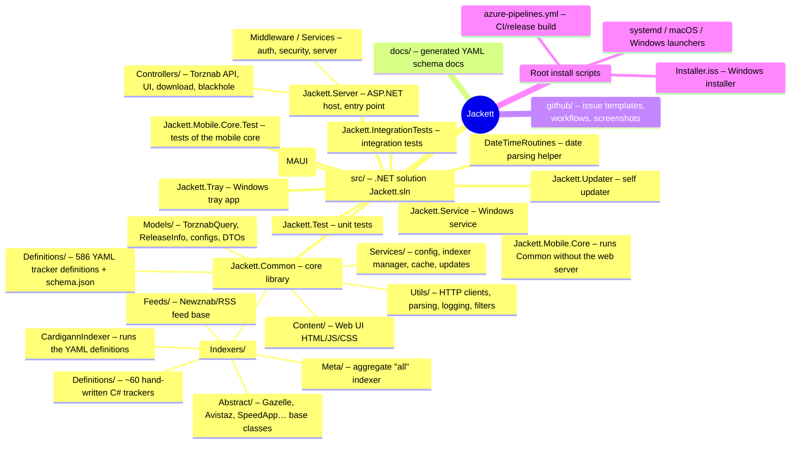
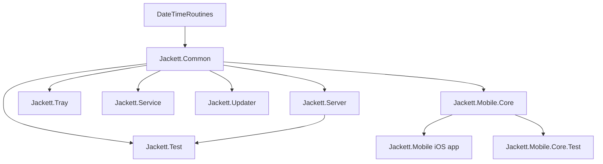

# Jackett – Repository Mind Map

Jackett is a proxy server: it takes Torznab/TorrentPotato queries from apps
(Sonarr, Radarr, Lidarr…), turns them into tracker-specific HTTP requests,
scrapes/parses the tracker's response, and returns results in a common format.



## Directory tree (top level)

```
Jackett/
├── src/
│   ├── Jackett.sln                 Solution file (lists all projects)
│   ├── Directory.Build.props       Shared build settings
│   ├── Jackett.Common/             ★ CORE – everything else depends on it
│   │   ├── Definitions/*.yml       586 YAML trackers (Cardigann engine) + schema.json
│   │   ├── Indexers/               Indexer engine + ~60 C# trackers
│   │   ├── Services/               ConfigurationService, IndexerManagerService, CacheService, UpdateService…
│   │   ├── Models/                 Torznab models, indexer config models
│   │   ├── Utils/                  WebClient(s), parsers, logging, filter funcs
│   │   └── Content/                Web dashboard (index.html, custom.js, bootstrap…)
│   ├── Jackett.Server/             ★ Main executable (ASP.NET Core): Program.cs, Startup.cs, Controllers
│   ├── DateTimeRoutines/           Used by Jackett.Common for date parsing
│   ├── Jackett.Tray/               Windows-only system tray app
│   ├── Jackett.Service/            Windows-only service wrapper
│   ├── Jackett.Updater/            Self-update helper
│   ├── Jackett.Test/               Unit tests (NUnit)
│   ├── Jackett.IntegrationTests/   Integration tests
│   ├── Jackett.Mobile.sln          Solution for the iOS app
│   ├── Jackett.Mobile/             iOS app (MAUI): search, indexer setup, in-app browser for Cloudflare
│   ├── Jackett.Mobile.Core/        Runs Jackett.Common without ASP.NET (used by the app)
│   └── Jackett.Mobile.Core.Test/   Tests of the mobile core
├── docs/                           ~250 auto-generated schema docs (from schema.json)
├── .github/                        Issue/PR templates, dependabot, workflows
│   └── workflows/                  codeql, definitions-update, issuebot, schema-docs, winget
├── azure-pipelines.yml             Build/release pipeline for all platforms
├── Installer.iss                   Inno Setup Windows installer
├── install_service_*.sh / *_macos  Linux/macOS service install/uninstall scripts
├── jackett_launcher.{sh,bat}       Launchers used by the updater
├── Upstart.config                  Legacy Upstart service config
└── README.md, CONTRIBUTING.md, SECURITY.md, LICENSE
```

## Project dependency graph



## Request flow

```
Sonarr/Radarr ──► Jackett.Server Controllers/ResultsController (Torznab API)
                    └─► IndexerManagerService ─► Indexer (C# class or CardigannIndexer + YAML)
                          └─► Utils/Clients/WebClient ─► tracker website
                    ◄── ReleaseInfo list ◄── parse HTML/JSON
```

## What can be removed? (quick guide)

| Item | Safe to remove? | Notes |
|------|-----------------|-------|
| Individual `Definitions/*.yml` | ✅ Yes | Just that tracker disappears. Check `Jackett.Test` for references. |
| Individual C# tracker in `Indexers/Definitions/` | ✅ Mostly | Remove any tests that reference it; abstract base classes are shared. |
| `docs/` | ✅ Yes | Generated docs; also remove `.github/workflows/schema-docs.yml`. |
| `.github/` screenshots, issue templates, workflows | ✅ Yes | Only affects GitHub UX/automation. |
| `Jackett.Tray`, `Jackett.Service` | ⚠️ Yes, if not on Windows | Remove from `Jackett.sln`, `Installer.iss`, `azure-pipelines.yml`. |
| `Jackett.Updater` + `jackett_launcher.*` | ⚠️ Yes, if no self-update | `UpdateService` in Common calls it; disable updates. |
| Install scripts / `Upstart.config` / `Installer.iss` | ⚠️ Per platform | Only packaging; referenced by `azure-pipelines.yml`. |
| `Jackett.Test`, `Jackett.IntegrationTests` | ⚠️ Possible | Lose test coverage; remove from `.sln`/pipeline. |
| `Jackett.Common`, `Jackett.Server`, `DateTimeRoutines` | ❌ No | Core of the app. |
